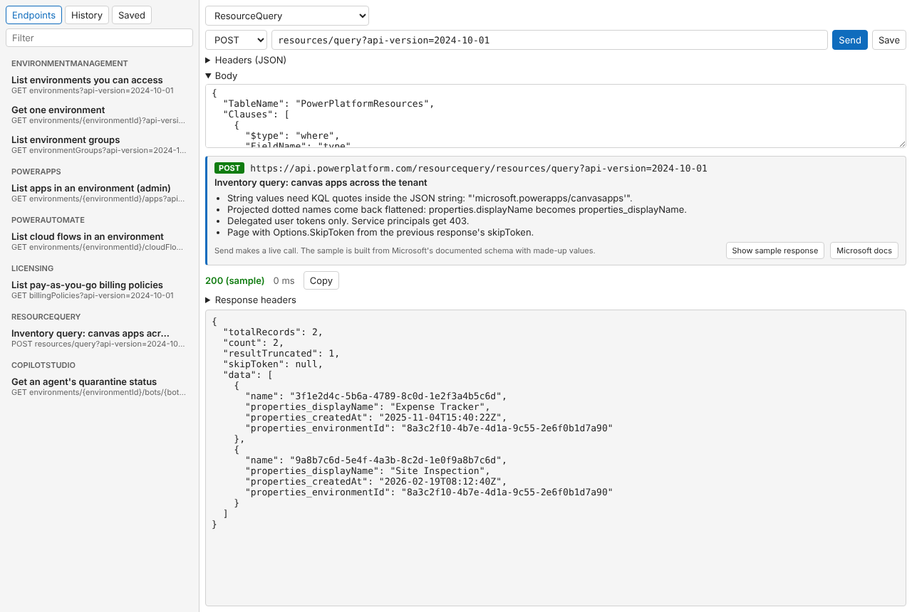

# API Explorer (PPTB tool)

Call the Dataverse Web API and the Power Platform API from Power Platform ToolBox, and see what SharePoint REST calls look like. Auth is handled by PPTB; the tool never sees tokens.

Goal: show people what they will actually get back from these APIs, since the official docs rarely do.



## v1
- Request builder: API (Dataverse or a Power Platform API area), connection, method, path, headers, body
- Response: status, timing, headers (Dataverse only), pretty JSON, copy
- Dataverse endpoint browser from $metadata (tables, unbound functions and actions)
- History (last 50) and saved requests, stored in tool settings
- Primary plus optional secondary connection
- Power Platform API catalog (8 endpoints across 6 areas): same docs cards, live Send, plus "Show sample response" built from Microsoft's documented schema. Samples in `src/samples/powerplatform.ts`.
- SharePoint REST catalog (16 endpoints): Swagger-style card per endpoint with the gotchas, and Send returns a realistic sample response. Not live. Samples live in `src/samples/sharepoint.ts`.

## How calls are made
- Dataverse: a one-operation `dataverseAPI.executeBatch`, the only host call that takes any method/URL and returns status + headers. Custom headers trigger PPTB's consent prompt.
- Power Platform API: `powerplatformAPI.<Area>.Get/Post/...`. The host returns only the body, so no status code or headers. The connection must have "enabled for Power Platform API" turned on in PPTB.

More background on how PPTB tools are built and authenticated: [docs/RESEARCH.md](docs/RESEARCH.md).

## Dev
```
npm install
npm run build      # outputs dist/ as a single IIFE bundle (PPTB has no module loader)
npm run dev-watch  # rebuild on change; load the project root via PPTB Debug > Load Local Tool
npm run validate   # pptb-validate
```
Then load the folder as a local tool in PPTB.

## Before publishing
- `pptb-validate` checks that the repository and readme URLs in package.json resolve, so the GitHub repo must exist and be pushed first.

## Later (parked, not v1)
- Live SharePoint calls (no host token API; upstream feature request or az/m365 CLI token via terminal)
- More Power Platform API endpoints (Governance, UserManagement, Analytics, PowerPages, ...)
- Microsoft Graph
- Bound Dataverse operations in the browser
- Copy as curl / code snippet (planned next, see `docs/snippets-plan.md`)
- Custom names for saved requests (Electron has no `prompt()`)
- MCP / agent invocation (pptb.config.json)
